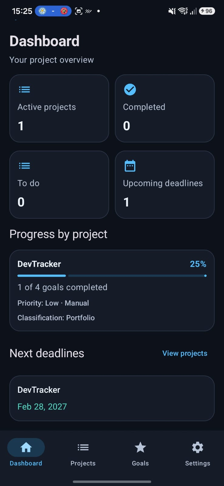
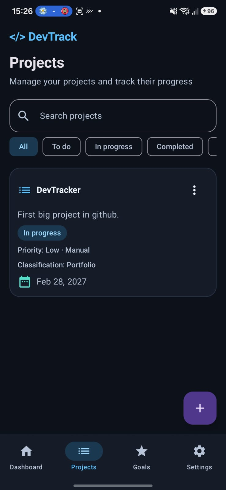
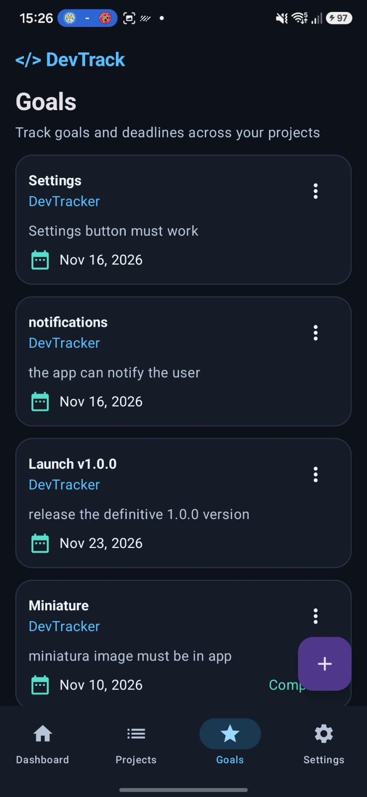
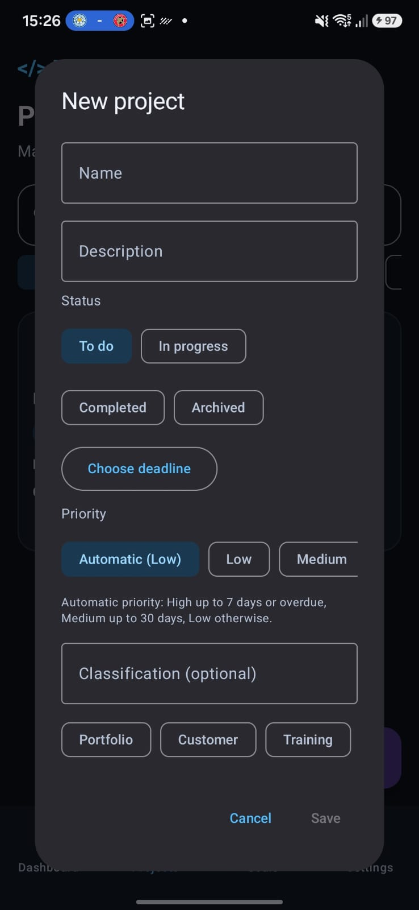
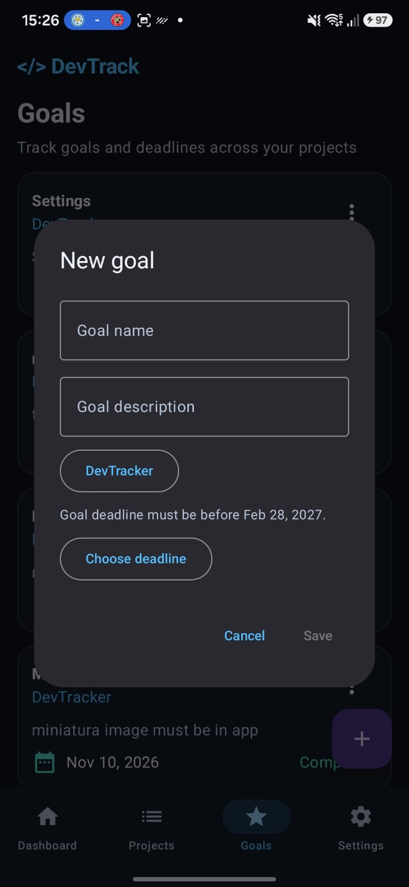
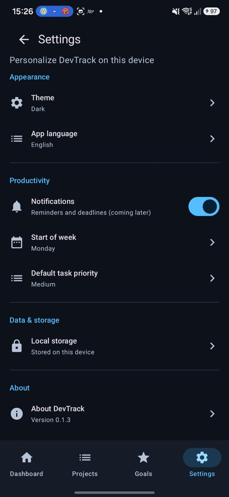

# DevTrack

<p align="center">
  <strong>A focused, offline-first Android workspace for projects, goals, and deadlines.</strong>
</p>

<p align="center">
  Built with Kotlin and Jetpack Compose, DevTrack keeps personal project planning simple, private, and available on the device you use every day.
</p>

<p align="center">
  
  
  
</p>

## Overview

DevTrack is a local-first project and goal tracker for developers and makers. Create projects, break them into measurable goals, assign deadlines, and use the dashboard to see progress at a glance—without an account, server, or network connection.

The current release is **0.1.3**. The app is being developed incrementally as a portfolio project, with a deliberately small and testable architecture.

## Highlights

- **Dashboard overview** — See active projects, completed projects, open work, upcoming deadlines, and goal completion progress.
- **Project management** — Create, search, filter, edit, archive, and delete projects.
- **Goal tracking** — Link goals to projects, enforce project deadline rules, and mark goals complete.
- **Priority and classification** — Use automatic or manual priority and group work as Portfolio, Customer, Training, or Study.
- **Offline-first storage** — Projects and goals are stored locally with Room/SQLite; no account or internet connection is required.
- **Personalized settings** — Choose light, dark, or system appearance and English or Brazilian Portuguese.
- **Privacy by design** — No external servers, synchronization service, or data collection layer is included.

## Screenshots

### Dashboard, projects, and goals

<p align="center">
  
  
  
</p>

### Create and personalize

<p align="center">
  
  
  
</p>

## Tech stack

| Area | Technology |
| --- | --- |
| Language | Kotlin |
| UI | Jetpack Compose and Material 3 |
| Navigation | Navigation Compose |
| Persistence | Room backed by SQLite |
| Async data | Kotlin Coroutines and Flow |
| Build | Gradle Kotlin DSL, Android Gradle Plugin |
| Testing | JUnit and AndroidX instrumentation tests |

## Requirements

- Android Studio with Android SDK 35
- JDK 17
- Android 8.0 (API 26) or newer for running the app
- An emulator or physical Android device for instrumented tests

## Build and run

1. Clone the repository and open it in Android Studio.
2. Allow Gradle to sync and install the required SDK components.
3. Select the `app` run configuration.
4. Run it on an Android 8.0+ emulator or device.

From a terminal, the main verification commands are:

```bash
./gradlew :app:assembleDebug
./gradlew :app:testDebugUnitTest
```

Instrumented tests require a connected device or running emulator:

```bash
./gradlew :app:connectedDebugAndroidTest
```

On Windows, use `gradlew.bat` instead of `./gradlew`.

## Architecture

The single `app` module is organized by responsibility:

- **UI** — Compose screens and navigation for Dashboard, Projects, Goals, and Settings.
- **View models** — Expose immutable `StateFlow` state and coordinate user actions.
- **Domain** — Repository contracts and project overview models.
- **Data** — Room entities, DAOs, database migrations, and local repositories.

Room observations stay off the main thread through Coroutines and Flow. Project and goal writes validate deadline rules, and deleting a project removes its linked goals through the database relationship. See [docs/ARCHITECTURE.md](docs/ARCHITECTURE.md) for more detail.

## Roadmap

Planned improvements include tasks, milestones, expanded dashboard statistics, notes, and local reminders. The roadmap intentionally preserves DevTrack's local-first and privacy-focused direction.

## License

DevTrack is released under the MIT License. See [LICENSE](LICENSE) for the full text.
